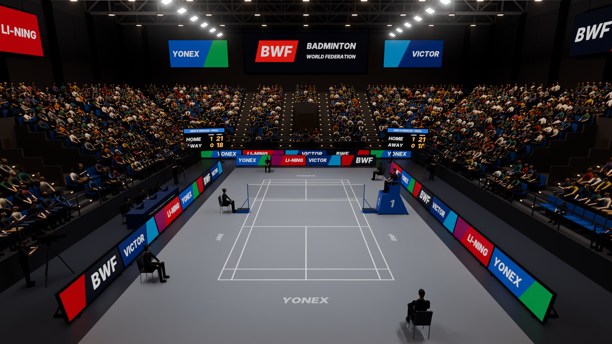
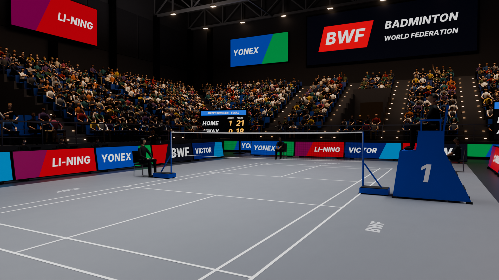
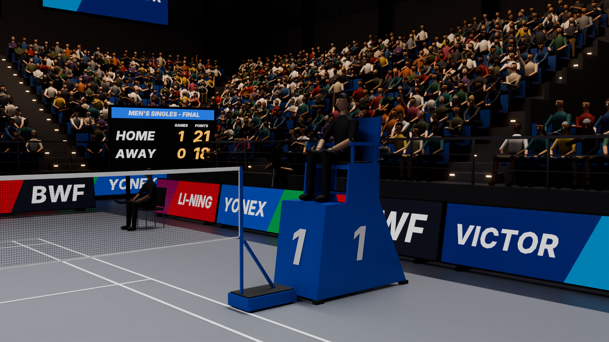
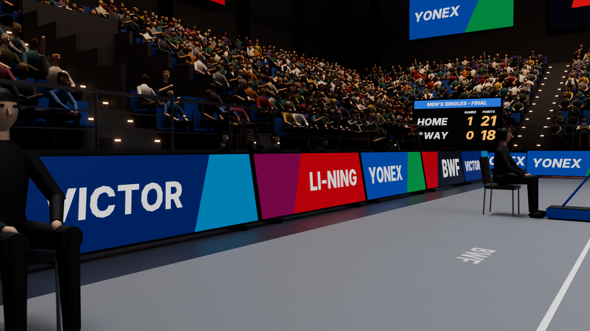
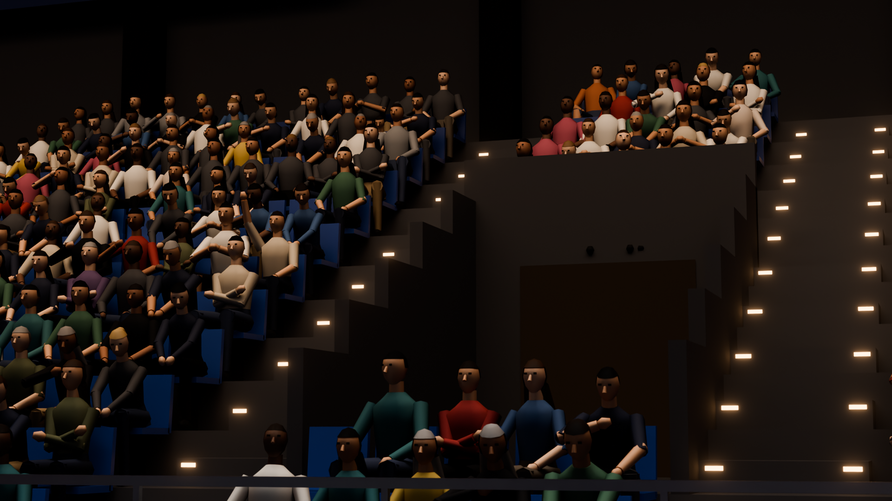
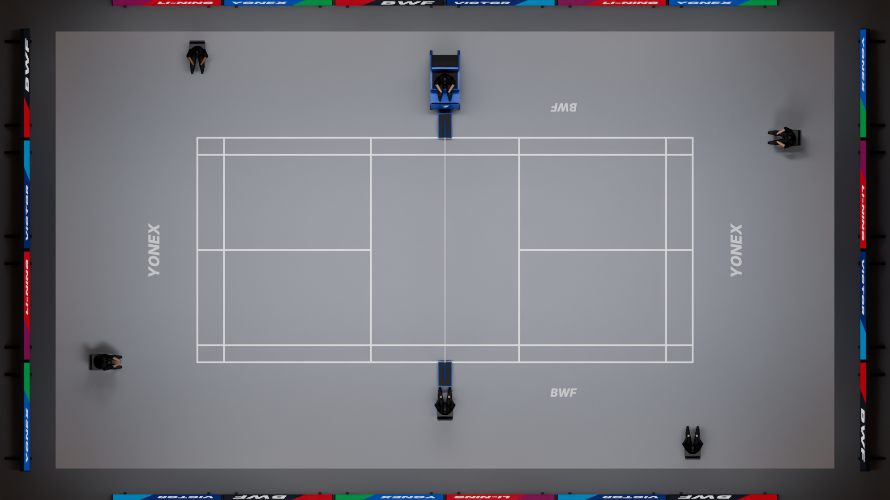

# Professional badminton indoor arena (Blender, Unity-ready)

A complete international-tournament badminton venue, generated by one Python script.
Everything in this folder was produced by `build_badminton_arena.py`; nothing was modelled by hand.

| Courtside gameplay camera | Umpire chair |
|---|---|
|  |  |
| **LED boards** | **Audience** |
|  |  |

## Files

| File | What it is |
|---|---|
| `build_badminton_arena.py` | The generator. Paste or open it in Blender and run it. |
| `BadmintonArena.blend` | The built scene (saved from Blender 4.5 LTS, opens in 4.5 and 5.x). |
| `renders/` | 1920×1080 Cycles renders of every camera, made from that `.blend`. |
| `unity_fbx/` | One FBX per collection, Y-up, metres, for Unity 6. |
| `fonts/` | Inter ExtraBold Italic (SIL Open Font License) used for the lettering. |

## Run it

- **In Blender:** Scripting workspace → Text → Open → `build_badminton_arena.py` → Run Script.
  Run it in a new file: by default it deletes every object in the current scene first (`CLEAR_SCENE` at the top of the script).
- **Headless:** `blender -b -P build_badminton_arena.py -- --save Arena.blend --render renders --export-fbx unity_fbx`
  Other flags: `--cams A,B`, `--samples 128`, `--scale 50`, `--engine EEVEE`, `--quick` (thin crowd for previews).

Keep the `fonts/` folder beside the script. Without it the script still runs and falls back to Blender's built-in font.
All dimensions, light powers, LED brightness, crowd occupancy and camera positions are constants at the top of the script.

## What is in the scene

Units are metres, Z up. The court is centred on the origin, long axis along Y, net along X.

| Collection | Contents |
|---|---|
| `ARENA_STRUCTURE` | Arena floor, four 12-row grandstands with stair aisles and entrance tunnels, 2,540 blue seats, rails, perimeter walls, columns, 10 exposed steel roof trusses, purlins, roof deck. |
| `BADMINTON_COURT` | Graphite-grey court mat (11.8 × 21 m) and subtle YONEX / BWF floor branding. |
| `COURT_LINES` | 12 separate line objects, 40 mm wide. |
| `NET_AND_POSTS` | Net with alpha-textured mesh and sag (1.55 m at posts, 1.524 m at centre), white top tape, two blue posts on weighted bases. |
| `LED_ADVERTISING` | 20 perimeter LED boards, 10 fascia ribbon boards, two rear-wall BWF screens, 8 wall banners. Each board and its lettering are separate objects. |
| `REFEREE_AND_OFFICIALS` | Blue elevated umpire chair with umpire, service judge, 4 line judges on chairs, tournament control desk with 3 officials, 2 scoreboards (HOME 1 / 21, AWAY 0 / 18), 3 TV camera positions with operators. |
| `SPECTATORS` | 2,269 seated spectators in four sub-collections (one per stand). |
| `LIGHTING` | 10 court floodlights, 4 audience washes, 2 officials fills, 2 roof washes, flown lighting rig with 22 fixture heads, house-light fittings. |
| `CAMERAS` | `CAM_Broadcast_Main` (20 mm wide shot), `CAM_Courtside_Gameplay`, `CAM_Umpire_Chair`, `CAM_LED_Detail`, `CAM_Audience`, `CAM_TopDown_Layout` (orthographic). |

### Court markings

Doubles court 13.40 × 6.10 m measured to the outer edges of the lines.

| Line | Position |
|---|---|
| Singles side lines | 0.46 m inside the doubles side lines (singles width 5.18 m) |
| Short service lines | 1.98 m from the net |
| Doubles long service lines | 0.76 m inside the back boundary lines |
| Centre lines | from each short service line to the back boundary |

### Lighting

The render is white balanced to the court lights (5400 K), so they read as neutral white and the 3700 K audience washes read as warm.
Court floodlights hang along both side lines and use a narrowed beam, so they cover the playing area and cut off before the opposite stand.

Linear luminance sampled from the main camera render:

| Region | Luminance | Relative to court |
|---|---|---|
| Court surface | 0.27 | 1.00 |
| LED boards (average over a board) | 0.27 | 1.00 |
| Spectator stands | 0.04 – 0.06 | 0.16 – 0.20 |
| Floor outside the boards | 0.03 | 0.12 |

Across the near half of the court the surface varies between 0.23 (corners) and 0.31 (centre).
White LED lettering peaks at about 0.83, brighter than the court; board backgrounds are well below it. Lower `LED_TEXT_STRENGTH` if you want the lettering under court level too.

### Spectators

There are 16 seated poses (hands on lap, leaning forward, arms crossed, clapping, on the phone, chin on hand, leaning back, arm raised), male and female builds, four hairstyles. Each pose is stored in 10 colour outfits, giving 160 shared meshes of about 600 triangles.
The 2,269 spectators are instances of those meshes with individual scale and rotation, so the `.blend` is under 2 MB.
Occupancy is about 90 %, with some empty pockets.

## Unity 6

- Import the FBX files from `unity_fbx/`. Each one is a collection, so the court, lines, net, LED boards, officials, crowd and structure stay separate and editable.
- Materials are single Principled BSDF materials (base colour, roughness, metallic, emission), which map to URP/HDRP Lit. Mesh UVs are box-projected at 1 UV unit per metre.
- Emissive materials: all names starting `LED_`, `Score_`, plus `Fixture_Lens`, `HouseLight_Lens`, `Aisle_StepLight`. Re-enable emission and add Bloom in the post-processing volume.
- The net is single-sided with an alpha texture (embedded in `NET_AND_POSTS.fbx`). Set its material to alpha clipping and Render Face: Both.
- Blender lights and cameras are not exported. Rebuild the lighting in Unity from the positions and values in `build_lighting()`.
- The crowd is 1.37 M triangles when every spectator is drawn. It uses 160 meshes and 34 materials, so enable GPU instancing on those materials, and consider LODs or impostors for the upper rows.

## What was checked, and what was not

Checked:

- The script builds without errors on Blender 4.5 LTS and 5.3, with and without the bundled font.
- The `.blend` saved from 4.5 opens in 5.3; the renders here were made that way.
- A back-face diagnostic render from all six cameras shows correct face orientation (under 0.03 % of pixels flagged).
- The FBX files were re-imported into Blender: all 2,448 mesh objects came back, with world bounds matching the source to within 0.002 mm.

Not checked:

- **Unity import.** Unity was not available here, so the FBX files have not been opened in Unity 6.
- **Eevee.** The machine that built this has no GPU. The script sets up Eevee when run with `--engine EEVEE`, but that path was never rendered.

Known limits:

- Spectators and officials are low-poly figures with simple geometric faces. They hold up in wide and medium shots; in close-ups they read as stylised, not photoreal. Replace them with scanned or rigged characters for hero shots.
- Brand names are plain text in a generic font. No official YONEX, LI-NING, VICTOR or BWF logo artwork is included.
- LED boards are static. There is no animated advertising loop.
- There are no players in the scene.
- Wall, floor and concrete surface variation is procedural and stays in Blender; the FBX files carry flat PBR values.
