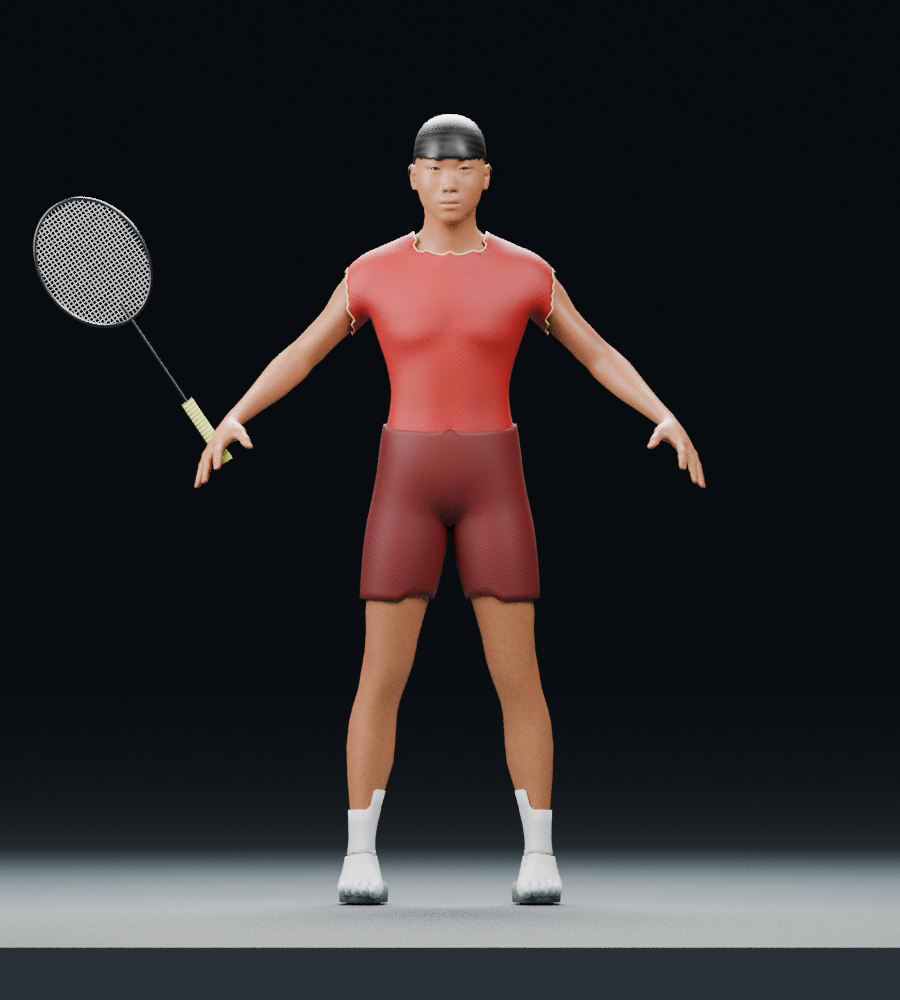

# Badminton athlete — rigged prototype

[Download ZIP](https://github.com/Nghoang123/THITRACNGHIEM/raw/refs/heads/badminton-athlete-package/deliverables/badminton-athlete-prototype/BadmintonAthlete_Package.zip)

Đây là **prototype có rig**, chưa đạt nhân vật chân thực giống Lee Chong Wei để đưa thẳng vào game.

- Nhân vật FBX, vợt FBX riêng, file Blender chỉnh sửa được.
- Rig 52 xương, trang phục, giày và texture thủ tục.
- Bốn ảnh preview, ba clip stress test và hướng dẫn import Unity.
- BLEND đã mở lại; cả ba FBX đã nhập lại bằng Blender; ZIP đã qua kiểm tra CRC.
- Chưa kiểm thử Unity 6, Humanoid Avatar, retarget, Animation Rigging hoặc Badminton Studio.
- Cần hoàn thiện khuôn mặt, tóc, trang phục, grip và kiểm tra/sửa biến dạng.
- Mesh giải phẫu MakeHuman CC0; giấy phép và nguồn trong Sources/ của ZIP.

ZIP chứa 51 tệp. Danh sách đầy đủ và hash từng tệp nằm trong MANIFEST_SHA256.txt.
Kiểm tra ZIP trên Windows PowerShell: `Get-FileHash .\BadmintonAthlete_Package.zip -Algorithm SHA256`
Đối chiếu với BadmintonAthlete_Package.zip.sha256 bên cạnh.

